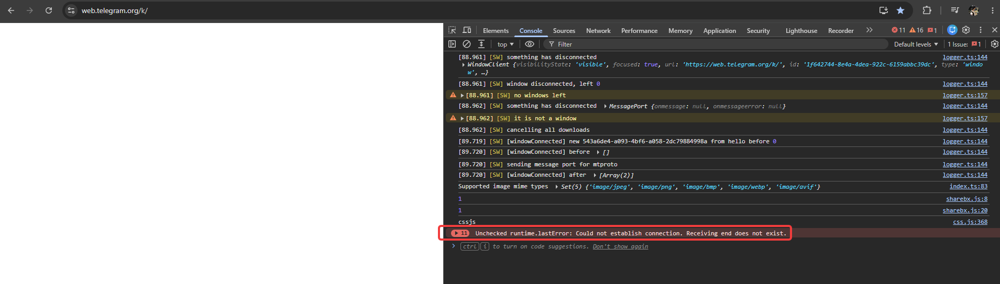
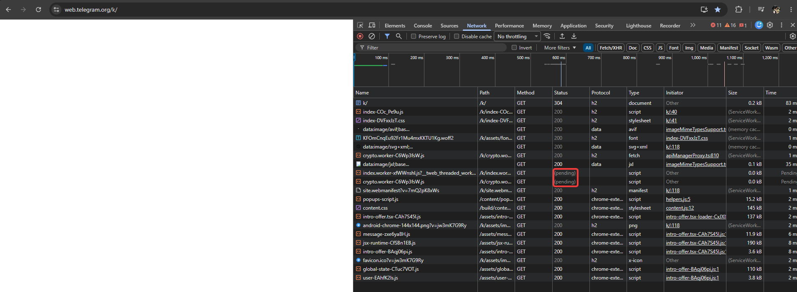

# 🐞 Кейс: Локализация бага «Белый экран» (White Screen of Death) в Telegram Web

## 📌 Краткое описание проблемы
При открытии веб-версии Telegram (`https://web.telegram.org/k/`) интерфейс приложения не загружается, отображается пустая белая страница. Проблема временно устраняется после многократной перезагрузки страницы.

---

## 🛠 Окружение (Environment)
* **OS:** Windows 11
* **Browser:** Google Chrome (v120+)
* **URL:** `https://web.telegram.org/k/`
* **Severity:** Critical (блокатор доступа к функционалу)

---

## 🔍 Процесс диагностики и локализации (DevTools)

### 1. Анализ консоли (Console Tab)
Во вкладке **Console** зафиксирована асинхронная ошибка среды выполнения:
`Unchecked runtime.lastError: Could not establish connection. Receiving end does not exist.`

> **Вывод:** Сбой вызова стороннего расширения браузера, блокирующий нормальное исполнение скриптов страницы.

### 2. Анализ сетевой активности (Network Tab)
Во вкладке **Network** выявлено бесконечное ожидание ответа:
* JS-воркеры `index.worker-xfWWnshI.js` и `crypto.worker-C6Wp3fsW.js` застряли в статусе **`(pending)`**.
* Обнаружены скрипты, внедряемые браузерными расширениями (`popups-script.js`, `chrome-extension://...`).

> **Вывод:** Приложение заблокировано на этапе инициализации DOM-дерева, так как критически важные фоновые скрипты Telegram не могут завершить загрузку из-за конфликта с кешем ServiceWorker и браузерными расширениями.

---

## 💡 Решение (Workaround) & Рекомендации
1. **Сброс кеша хранилища:** `DevTools -> Application -> Storage -> Clear site data`.
2. **Запуск без сторонних скриптов:** Открытие в режиме Инкогнито (`Ctrl + Shift + N`) без сторонних расширений подтвердило корректную работу приложения.
